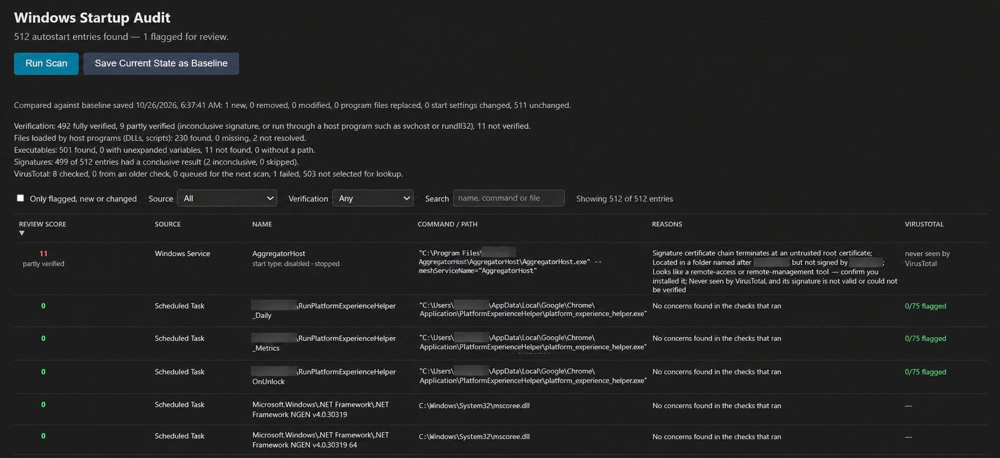

# Windows Startup Audit

[](https://github.com/riddhi6000/winstartup-audit/actions/workflows/tests.yml)

A local tool that lists everything set to start on a Windows machine, checks what each entry
really runs, and points out the ones worth a closer look. It also remembers what your machine
looked like when you last trusted it, so it can tell you what changed.



It is a **review aid, not an antivirus**. Every number it shows is a count of reasons to look
closer, not a probability that something is malicious, and it says what it could and could
not check instead of treating "nothing found" as "clean".

## What it looks at

| Source | Where it looks |
| --- | --- |
| Registry Run keys | `Run` and `RunOnce` (current user, all users, 32-bit) and the Group Policy `Explorer\Run` keys |
| Startup folders | Per-user and all-users folders, including where each `.lnk` shortcut points |
| Scheduled tasks | Every action of every task (programs and COM handlers), read with `Get-ScheduledTask` |
| Services | Every service, whatever its start type, with its start type and state |
| Winlogon | The `Shell` and `Userinit` values that run during sign-in |

Entries switched off in Task Manager's Startup tab are recognised and marked as disabled.

## How an entry is judged

1. **Find what it really runs.** Variables such as `%windir%` are expanded and bare program
   names are looked up in the Windows folders only. When the program is only a host,
   the file it loads is found too: the DLL behind `rundll32.exe` and `regsvr32.exe`, the
   `ServiceDll` behind a service run by `svchost.exe`, the script behind `cmd`, `powershell`
   and the script hosts, and the target of a COM handler.
2. **Check the signature** of the program and of the DLL it loads, using
   `Get-AuthenticodeSignature`.
3. **Apply the rules** below to produce a *review score*.
4. **Ask VirusTotal** about the files where the answer matters most, within a per-scan limit.
5. **Compare with the baseline** and add what changed.
6. **Report coverage**: how many entries were fully verified, partly verified or not verified,
   and which scanners could not read everything.

### Review score

A higher number means more reasons to take a closer look. Zero means "no concerns in the checks
that ran", which the dashboard qualifies with how much was actually verified.

| Reason | Points |
| --- | ---: |
| Winlogon value missing, or different from its expected default | 4 |
| Signature broken or untrusted (hash mismatch, not trusted, untrusted root certificate) | 4 |
| Starts a dual-use Windows utility with hidden, encoded or download-and-run arguments | 4 |
| Program file replaced since the baseline, and no longer validly signed by the same publisher | 4 |
| In a Microsoft-named folder but not signed by Microsoft | 3 |
| Command changed since the baseline | 3 |
| Was disabled in the baseline and is enabled now | 3 |
| Not digitally signed | 2 |
| Runs from a Temp or Downloads style folder | 2 |
| Looks like a remote-access or remote-management tool | 2 |
| Never seen by VirusTotal, and the signature is not valid | 2 |
| Signature check was inconclusive | 1 |
| Created in the last 30 days, and not covered by a verified signature | 1 |
| Start type changed to Auto since the baseline | 1 |
| VirusTotal: at least 10% / 30% / 60% of engines flagged it | 5 / 10 / 15 |

Files loaded by a host program (a DLL, a service DLL) are scored with the same rules. Anything
already counted for the entry's own command, such as a Temp-folder path, is not counted twice.

### VirusTotal

Only SHA-256 hashes are sent. Files are never uploaded. A free-tier key allows about four
requests a minute, so each scan makes at most 8 real requests, most important files first
(strong local concerns, then other flagged files, then unsigned ones, then files signed by
someone other than Microsoft). Files that do not fit are marked "queued for the next scan".
A stored answer is trusted for 7 days, and a "not found" answer for one day.

## Baseline

*Save Current State as Baseline* records each entry's identity, command, program file
fingerprint, signer and start setting. Later scans report what is new, removed or changed.

- Ordinary updates are not noise: a new version folder, or a program that was replaced but is
  still validly signed by the same publisher, is listed as a routine update and not scored.
- Identifiers that Windows rotates by itself (GUIDs in task names, per-user service suffixes,
  hashes in Edge entries, versions in names) are matched up and not reported as changes.
- Saving is refused if a scanner failed, and asks for confirmation while anything is flagged,
  because everything in a baseline is treated as normal from then on.
- The file has a version number and a checksum, and the previous five baselines are kept in
  `baseline_history/`. The checksum catches damage and casual edits; it is not protection
  against someone who can rewrite the file and recompute it.

## Running it

Requirements: Windows 10 or 11 and Python 3.12 or newer (developed on 3.13).

```powershell
git clone https://github.com/riddhi6000/winstartup-audit.git
cd winstartup-audit
python -m venv venv
.\venv\Scripts\Activate.ps1
pip install -r requirements.txt

copy .env.example .env      # then put your VirusTotal API key in .env (optional)

python -m uvicorn winaudit.api:app --app-dir src --reload
```

Open <http://127.0.0.1:8000> and click **Run Scan**. The first scan can take a few minutes
while new files are checked; later ones are much faster. Without an API key everything works except the VirusTotal lookups, which are switched off; the dashboard says so. For the most complete
view, run from an elevated PowerShell; the coverage panel lists anything that could not be read.

## Command line

  python -m winaudit scan --json report.json     # scan and write a full report
  python -m winaudit scan --redact --json sample.json   # remove user/computer names for sharing
  python -m winaudit compare first.json second.json     # do two scans agree?

## Security of the tool itself

It is meant to run on your own machine only.

- The server listens on `127.0.0.1`. Do not start it with `--host 0.0.0.0`.
- There is no CORS. Every API call must carry a random per-run token that only the page served
  by the server receives, and requests from other origins or with a foreign `Host` header are
  refused, so a web page you visit cannot read your scan or overwrite your baseline.
- The page uses a Content-Security-Policy with a per-request nonce and loads nothing from
  outside.
- One scan runs at a time. Errors shown in the browser are generic; details go to the console.
- PowerShell is always started from the Windows folder by absolute path, and file paths are
  passed through the environment, never written into script text.
- `.env`, the baseline, its history and the hash cache are listed in `.gitignore`.

## Project layout

```text
src/winaudit/
  api.py              FastAPI app: scan pipeline, baseline endpoints, security checks
  scanners/           one module per source; each returns entries plus what it could not read
  risk.py             path resolution and the scoring rules
  payload.py          finds the DLL or script a host program will load
  signature.py        Authenticode checks
  virustotal.py       lookups, per-scan budget and freshness of stored answers
  lookup_policy.py    which files get a lookup, in what order
  hash_cache.py       SQLite cache of VirusTotal answers
  baseline.py         saving, checksum, history and the comparison
  coverage.py         how much of the machine was actually checked
  startup_approved.py Task Manager's enabled/disabled records
static/index.html     the dashboard (filters, sorting, coverage)
tests/                unit and pipeline tests
```

## Tests

```powershell
pip install -r requirements-dev.txt
python -m pytest -q
```

More than 350 tests run without touching the real registry, PowerShell or network. They also
cover the security checks, the dashboard page and a regression case modelled on a real
remote-access agent that was found on a development machine during testing (only the scan
data is reproduced, never the file). The suite runs on Windows in GitHub Actions.

## Limitations

- **Not an antivirus.** It does not look inside files. A validly signed program can still be
  harmful, and a malicious script has no signature to check; scripts are only located and
  fingerprinted.
- **Locations not covered yet:** Image File Execution Options debuggers, `AppInit_DLLs`,
  Active Setup, WMI event subscriptions, the legacy `Windows\Load` and `Run` values, the
  Startup-folder override in `User Shell Folders`, and kernel drivers.
- **Per-user paths** such as `%LOCALAPPDATA%` are expanded for the account the server runs as,
  which can differ from the account an entry runs as.
- **Task Manager's disabled records** use an undocumented format (an odd first byte means
  disabled). It was checked against Task Manager on one machine, not on every Windows version.
- The baseline checksum is not authentication, and a program swapped without any recorded
  fingerprint cannot be detected until a baseline containing it is saved.
- The free VirusTotal tier limits how fast coverage of new files grows.
- Programs that cannot be read, such as Microsoft Store app files, get no fingerprint, so a later
  swap of them cannot be detected; the dashboard counts them.

## Future work

Cover the locations listed above, analyse script contents, sign the baseline with a key held
outside the project folder, and export a report.

## License

MIT. See [LICENSE](LICENSE).
